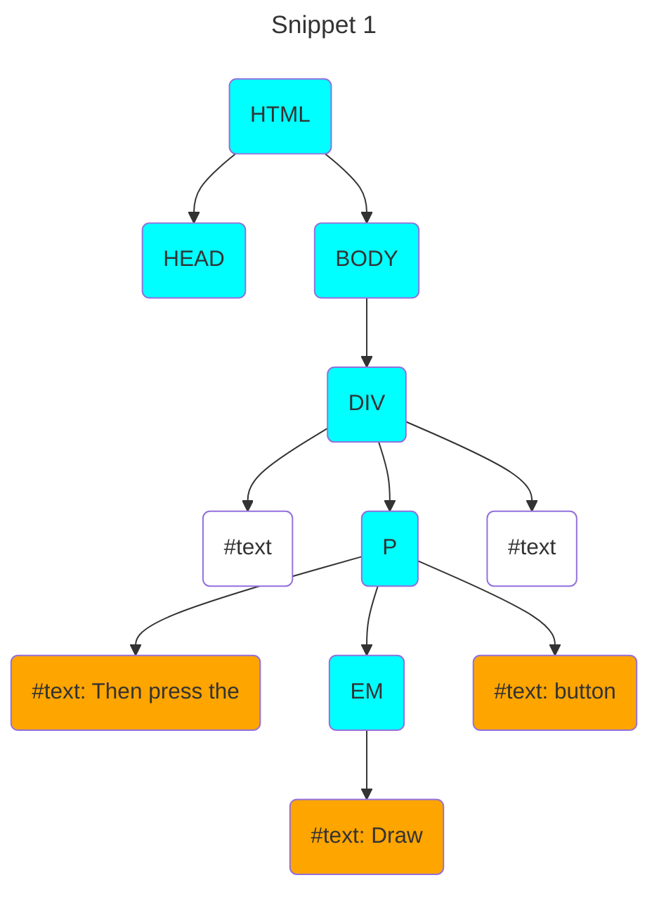
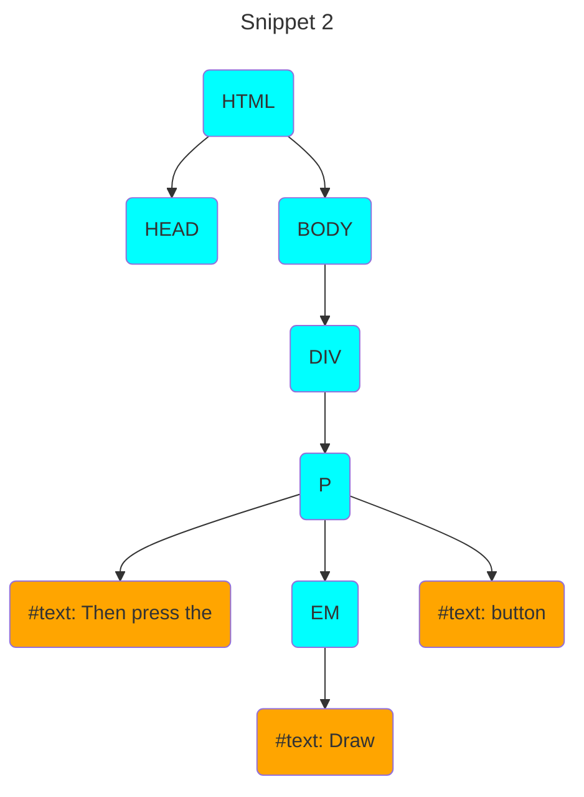

## Diagram Key

| Color | Meaning |
|-|-|
| <span style="color:#00FFFF">aqua</span> | element nodes |
| <span style="color:#FFA500">orange</span> |  text nodes with content |
| <span style="color:#FFFFF">white</span> | text nodes with whitespaces |

## HTML Snippet 1

```html
<body>
  <div>
    <p>Then press the <em>Draw</em> button</p> 
  </div>
</body>
```



## HTML Snippet 2

```html
<body>
  <div><p>Then press the <em>Draw</em> button.</p></div>
</body>
```

