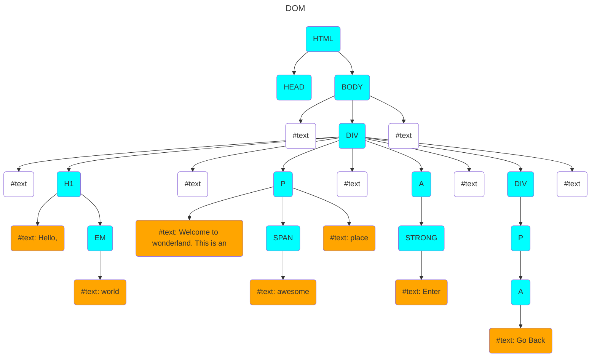

## Question

> How many direct and indirect child nodes does each parent node — starting with the element with an id of 1?
>  
> Consider the following when counting the direct and indirect child nodes for each parent node:
> How many direct and indirect child nodes does each parent node — starting with the element with an id of 1 — have in the DOM generated by the following HTML:
> - Any DOM node that has at least one child node is a parent node.
> - Indirect child nodes are all descendants of a node's direct children, excluding the direct children themselves.

## Answer

direct child node
: a child node that is an **immediate** decendant of a parent

indirect child node
: a child node that is NOT an immediate decendant, but rather shares an ancestor (grandparent, etc.)

```html
<body>
  <div id="1">
    <h1 id="2">Hello, <em id="3">World</em></h1>
    <p id="4">
      Welcome to wonderland. This is an
      <span id="5">awesome</span> place.
    </p>
    <a href="#" id="6"><strong id="7">Enter</strong></a>
    <div id="8"><p id="9"><a href="#" id="10">Go back</a></p></div>
  </div>
</body>
```



| Element w/ ID | Direct Child Nodes | Indirect Child Nodes |
|-:|:-:|:-:|
| `div` 1 | 9 | 12 |
| `h1` 2 | 2 | 1 |
| `em` 3 | 1 | 0 |
| `p` 4 | 3 | 1 |
| `span` 5 | 1 | 0 |
| `a` 6 | 1 | 1 |
| `strong` 7 | 1 | 0 |
| `div` 8 | 1 | 2 |
| `p` 9 | 1 | 1 |
| `a` 10 | 1 | 0 |

## Further Exploration

> Write code that returns the number of direct and indirect child nodes for a given parent node as an array.

```javascript
function walk(node, callback) {
  callback(node);

  for (let i = 0; i < node.childNodes.length; i++) {
    walk(node.childNodes[i], callback);
  }
}

function childNodes(parentId) {
  let parent = document.getElementById(parentId);
  let direct = 0;
  let indirect = 0;

  walk(parent, (node) => {
    if (node === parent) return;

    if (node.parentNode === parent) {
      direct++;
    } else if (parent.contains(node)) {
      indirect++;
    }
  })

  return [direct, indirect];
}

// sample output
childNodes(1);
// [9, 12]
childNodes(4);
// [3, 1]
childNodes(9);
// [1, 1]
```
